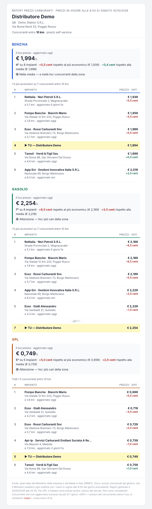

# Competitive Pricing Intelligence

Python system that ingests public government datasets daily, computes
competitive positioning on a geographic basis, and delivers automated
reports by email.

## The problem

Businesses operating across multiple locations need to know how their prices
compare to nearby competitors, every day. Public data exists, but it is raw,
high-volume and unusable without processing — so the comparison is either
done manually or not at all.

## What it does

- **Automated daily ingestion** of the Italian MIMIT open dataset
  (locations registry + price feed)
- **Parsing and merging** of heterogeneous sources into a single dataset
- **Geocoding** of client addresses into coordinates
- **Geospatial analysis**: identifies competitors within a configurable
  radius of each location
- **Competitive ranking**: national position and gap vs the cheapest
  competitor, per fuel type
- **Automated email delivery**, one report per client, multiple recipients


## Sample output



*Generated with demo locations from the public MIMIT dataset.*

## Results

- Processes **23,700+ locations** and **74,900+ daily price records**
- Ranks each location against **33,900+ competitors** nationwide
- Runs end to end with no manual intervention
- Reports delivered within minutes of data availability

## Stack

Python 3.14 · pandas · NumPy · Requests · Geopy · SQLite · SMTP

## Use case

Built for the fuel retail market, where prices are published by law.
The architecture applies to any sector with open pricing data and
location-based competition.

## Setup

```bash
python3 -m venv venv
source venv/bin/activate
pip install -r requirements.txt

cp .env.example .env                      # SMTP credentials
cp clienti.example.json clienti.json      # your locations

python main.py
```

## Data

All data is retrieved from public open-data sources.
No proprietary or client data is included in this repository.
